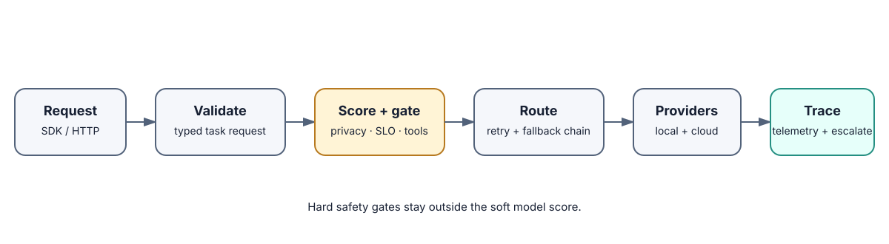
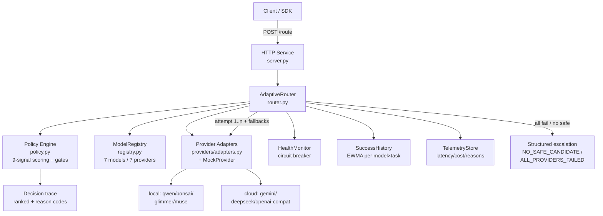

# adaptive-llm-gateway

A polished, runnable **adaptive inference gateway** — not a keyword router. It scores every
candidate model across nine signals, explains each decision with reason codes + a full decision
trace, and executes with fallback chains, bounded retries, per-provider timeouts, health-gated
routing, telemetry, and structured escalation.

- **Stack:** Python 3.10+, **zero runtime dependencies** (stdlib only: `http.server`, `urllib`,
  `concurrent.futures`). Dev tools (`pytest`, `ruff`, `mypy`) are optional extras.
- **API:** `POST /route` (+ `GET /health`, `GET /metrics`) and a reusable SDK (`GatewaySDK`
  in-process, `GatewayHTTPClient` over HTTP).
- **Providers:** local **Qwen / Bonsai / Glimmer / Muse**, **Gemini**, **DeepSeek**, and a generic
  **OpenAI-compatible** endpoint — all working **offline with mock transports, no credentials needed**.
- **Eval:** committed offline fixtures + harness producing `eval/eval-results.json` (machine-readable)
  and `eval/REPORT.md` (human-readable). Synthetic mocks only — **no live benchmark claims**.

**Status:** public, mock-first V1 infrastructure reference implementation. The
catalog, traces, and evaluation fixtures are synthetic; no provider credentials or
private customer data are included.

## Architecture





### Request lifecycle

1. **Validate** (`TaskRequest.validate`) → `VALIDATION_ERROR` escalation on bad input.
2. **Score** every model in `ModelRegistry` with `policy.score_candidates`:
   task affinity, expected quality vs difficulty, latency SLO fit, cost budget fit, privacy,
   context headroom, tool capability, health, history — weighted sum, deterministic, ties by `model_id`.
3. **Gate**: privacy violations, context overflow, missing vision/tools, and circuit-open models are
   **excluded** (not just down-ranked). Zero survivors → `NO_SAFE_CANDIDATE` escalation.
4. **Execute** ranked fallback chain: up to `max_attempts_per_provider` tries per provider, each with
   a per-provider timeout; bounded total budget (`max_total_ms`) and bounded concurrency (semaphore).
5. **Record** health + history + telemetry on every attempt; first success wins, else
   `ALL_PROVIDERS_FAILED` escalation (never hallucinated text).

## Setup

```bash
git clone <this-repo> && cd adaptive-llm-gateway
cp .env.example .env          # optional; defaults work with zero config
# No runtime install needed (stdlib only). For dev tools:
python3 -m pip install -e ".[dev]"
```

Requires Python ≥ 3.10. No inference servers, no API keys, no paid APIs — ever.

## Quickstart

```bash
# 1. Run the service
python3 -m adaptive_gateway --port 8080   # src/ on path via pip install -e . OR:
PYTHONPATH=src python3 -m adaptive_gateway --port 8080

# 2. Route a request
curl -s localhost:8080/route -H 'Content-Type: application/json' -d '{
  "prompt": "Refactor this async pool to fix the reconnect race.",
  "task_type": "code", "difficulty": "hard", "context_tokens": 4000
}' | python3 -m json.tool

# 3. Health + metrics
curl -s localhost:8080/health | python3 -m json.tool
curl -s localhost:8080/metrics | python3 -m json.tool
```

### curl demo (private data stays local, vision, fallback path)

```bash
# Private data → forced local (cloud models excluded by gate)
curl -s localhost:8080/route -H 'Content-Type: application/json' -d '{
  "prompt": "Summarize these discharge notes.",
  "task_type": "private_data", "privacy_local_only": true
}' | python3 -c "import json,sys; d=json.load(sys.stdin); print(d['model_id'], d['ranked'][0]['reason_codes'])"

# Vision → vision-capable model only
curl -s localhost:8080/route -H 'Content-Type: application/json' -d '{
  "prompt": "Describe the chart.", "task_type": "vision", "needs_vision": true
}' | python3 -c "import json,sys; print(json.load(sys.stdin)['model_id'])"
```

### SDK use

```python
from adaptive_gateway.sdk import GatewaySDK
sdk = GatewaySDK()  # in-process, mock providers, no HTTP
out = sdk.route("Write quicksort in Rust.", task_type="code", difficulty="hard")
print(out["model_id"], out["ranked"][0]["reason_codes"])
sdk.close()
```

### Demo (representative end-to-end, mock providers)

```bash
PYTHONPATH=src python3 -m demo.demo
```

Covers: coding / private-data / vision / fast-task scenarios, plus failure→fallback,
retry-then-success, and escalation paths with printed decision traces.

## API reference

### `POST /route`

Request (all fields optional except `prompt`):

| Field | Type | Default | Meaning |
|---|---|---|---|
| `prompt` | string | — | user prompt (required, non-empty) |
| `task_type` | enum | `chat` | `code\|chat\|reasoning\|vision\|private_data\|fast\|tool_use` |
| `difficulty` | enum | `medium` | `easy\|medium\|hard` (raises quality floor) |
| `max_latency_ms` | int | none | SLO; shapes latency subscore + per-attempt timeout |
| `max_cost_usd` | float | none | budget; over-budget models score 0 on cost |
| `privacy_local_only` | bool | false | hard gate: cloud models excluded |
| `context_tokens` | int | 1024 | overflow vs model window = hard exclusion |
| `needs_vision` / `needs_tools` | bool | false | hard capability gates |
| `metadata` | object | {} | passthrough |

Response: `RouteResult` JSON — `ok`, `escalated`, `model_id/provider/text/latency_ms/cost_usd`,
`attempts[]` (per-try records with error codes), `ranked[]` (full decision trace: score, subscores,
reason codes, exclusions), `weights`, `error` (structured `{code,message,provider,retryable,hint}` on failure).
HTTP status: `200` success, `503` escalation, `400` malformed JSON, `413` oversize body.

### `GET /health` → `{status, version, mode, models: {id: bool}}`
### `GET /metrics` → telemetry snapshot (counts, success rate, p50/p95 latency, cost, reason/error breakdowns)

## Configuration

`config/default.json` holds synthetic defaults; env vars override (`GATEWAY_MODE`,
`GATEWAY_WEIGHTS_JSON`, `GATEWAY_MAX_ATTEMPTS_PER_PROVIDER`, `GATEWAY_DEFAULT_TIMEOUT_MS`,
`GATEWAY_MAX_TOTAL_MS`, `GATEWAY_MAX_CONCURRENCY`). `GatewayConfig.validate()` fails fast at startup.
Provider credentials (`GEMINI_API_KEY`, `DEEPSEEK_API_KEY`, `OPENAI_COMPAT_BASE_URL`, … — see
`.env.example`) are **only** consulted in `GATEWAY_MODE=live`; default `mock` mode never touches the network.

## Evaluation

```bash
PYTHONPATH=src python3 -m eval.harness   # writes eval/eval-results.json + eval/REPORT.md
```

10 offline scenarios (coding-hard, private-local-only, vision, fast-SLO, fallback-on-failure,
retry-flaky, timeout-fallback, all-fail escalation, no-safe-candidate escalation, tool-use) assert
**routing invariants** (privacy never leaks to cloud, capability gates hold, fallbacks preserve
success, outages escalate with the right code) — never live quality claims. See `eval/REPORT.md`
for the latest run. All numbers in the model catalog are synthetic scoring priors, not benchmarks.

## Tests / lint / typecheck / build

```bash
python3 -m unittest discover -s tests -v   # zero-dependency test run
python3 -m pytest -q                       # with dev extras installed
ruff check src eval demo tests
mypy src
python3 -m compileall -q src eval demo tests  # build check (stdlib-only project)
# or: make test | make lint | make typecheck | make eval | make demo
```

## Design rationale

- **Why scoring, not keywords?** Keywords break on paraphrase and ignore SLOs/budgets/privacy.
  Weighted multi-signal scoring degrades gracefully and every decision is auditable via reason codes.
- **Why hard gates + soft scores?** Safety (privacy/context/capability) must be binary; everything
  else is a tradeoff. Mixing them into one score would let a fast model win a private-data task.
- **Why stdlib-only runtime?** Overnight V1 reliability: `pip install` never blocks quickstart, the
  attack surface is tiny, and the service runs anywhere Python 3.10+ exists.
- **Why mock-first providers?** The registry contract (all 7 families routable day one) is testable
  without secrets; live adapters validate env and fail with `CONFIG_ERROR` instead of hanging.
- **Why EWMA history + circuit breaker?** Live systems need memory: repeated failures should sink a
  model temporarily (circuit) and shift future rankings (history), without manual intervention.

## Limitations

- Mock transports return templated text — this V1 routes and orchestrates; it does not generate.
- Live adapters validate credentials but do not yet stream real provider HTTP (marked in metadata).
- No persistence: telemetry/history/health reset on restart (in-memory by design for V1).
- No auth/rate-limiting on the HTTP service; run behind a gateway for multi-tenant use.
- Weights are static defaults; no online learning yet (history EWMA is the only adaptive memory).

## Recruiter lens

This project demonstrates production-oriented AI infrastructure concerns rather than
just a model wrapper: hard privacy and capability gates, deterministic routing
traces, bounded retries and fallbacks, health-aware selection, and structured
escalation when no safe model is available. It is a V1 reference implementation,
not a claim of hosted multi-tenant production scale.

## Roadmap

- Real streaming HTTP adapters + SSE passthrough; per-provider auth/quotas.
- Persistent telemetry/history (SQLite/Postgres) + dashboard.
- Adaptive weight tuning from eval harness outcomes.
- Budgets per tenant, request coalescing, caching of identical prompts.
- OpenTelemetry tracing export + Prometheus `/metrics` exposition format.

## License recommendation

**MIT** (see `LICENSE`) — permissive, standard for gateway/SDK infrastructure, keeps adoption friction
near zero. If shipping inside a commercial SaaS with patent concerns, consider Apache-2.0 instead.
